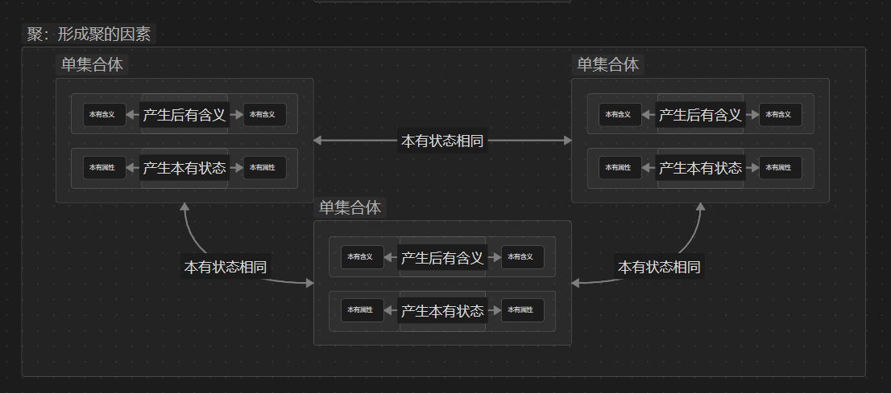

# 基底方法论（新）

> 这一版是 2026-11 重写的方法论正文。
> 下面的三张图是结构示意，和图对应的说明见文末。

---

## 基础处理：

元素=模糊个体（具有模糊性、原始性、非逻辑性）
将元素拆分为：本体含义与本体属性

处理元素组合中的含义
元素中的本有含义与另外元素中的本有含义产生**后有含义**

处理元素组合中的属性
元素中的本有属性与另外元素中的本有属性产生**状态**
*状态分为本有状态和即时状态*
## 元素产生的集合体：

多元素产生集合体=模糊团
简单处理双模糊团由：处理元素组合中的含义与处理元素组合中的属性共同分开处理
本有含义与另外本有含义交互组成后有含义；本有属性与另外本有属性产生即时状态

## 特殊机制：

当模糊团需要产生本有状态时：
聚：
	在模糊团中由特殊组合（两个特定元素）产生本有状态（逻辑与*处理元素组合中的属性*相同），以本有状态与另外模糊团（双/多）本有状态产生重叠态（本有状态必须相同），聚为元素产生隐形集合
散：
	在模糊团中由特殊组合（两个特定元素）产生本有状态（逻辑与*处理元素组合中的属性*相同），由原有模糊团中的本有状态散为因素，与另外模糊团（一或多）中的本有状态产生重叠态（本有状态必须相同）

## 哲学：
现在（进行时）=过去的未来=未来的过去

过去（节点1）- 现在（节点2）- 未来（节点3）
	示例：
	在节点1想写一段文字，在节点2进行写文字的进程（中间基于节点1进行修改等），在节点3写完节点1与节点2的文字
	*进程中，站在节点1的角度节点2为未来，站在节点2的角度节点1为过去节点3为未来，站在节点3的角度节点2为过去*，即站在节点2的角度-节点1与节点3是重叠态

将节点具有的事/物（元素）拆分为含义与属性
	示例：
	节点1中含义与节点2的含义进行交互（处理元素中的含义），其中节点1的含义作用于节点2，节点2反作用于节点1，此时产生后有含义，同理，节点2作用于节点3，节点3反作用于节点2
	节点1中的属性与节点2的属性进行交互产生即时状态（处理元素组合中的属性），即时状态产生*修改等动作*，同理，节点2的属性与节点3的属性进行交互产生即时状态
	
本有属性交互产生即时状态，即时状态影响含义自然产生后有含义

---

## 结构图

### 1. 基础双集合体

- **本有含义 × 本有含义 → 后有含义**
- **本有属性 × 本有属性 → 即时状态 / 本有状态**

### 2. 聚：形成聚的因素

- **至少 3 个**单集合体
- 彼此 **本有状态相同** → 连成一张网（隐形集合）
- **形成的隐形集合体，方向自定义**

### 3. 散：作为因素散入

- 一个单集合体的**本有状态**作为**因素**
- 散入另一个（或多个）集合体，条件是 **本有状态相同**
- 散完得到 **后有含义**
