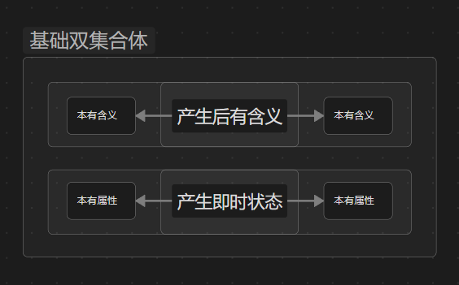
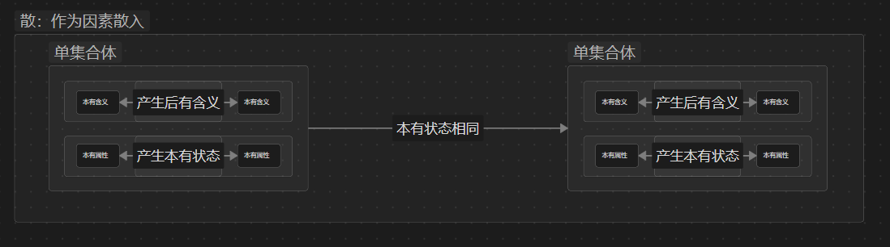

# 基底方法论

## 一、元素

**元素 = 模糊个体**：具有模糊性、原始性、非逻辑性。

每个元素拆成两样：

| | 是什么 |
|---|---|
| **本有含义** | 这个元素是什么 |
| **本有属性** | 这个元素是什么性质 |

---

## 二、两个元素放在一起

两条线**分开走**，谁也不替谁下结论：

```
本有含义 × 本有含义 → 后有含义
本有属性 × 本有属性 → 状态
```

---

## 三、集合体

**多个元素产生集合体**（也就是模糊团），这个就是**单集合体**。

**两个集合体 → 双集合体。**

两个集合体之间，同样分两条线处理：

```
本有含义 × 本有含义 → 后有含义
本有属性 × 本有属性 → 即时状态
```

---

## 四、两种状态

| 状态 | 在哪产生 | 怎么来 |
|---|---|---|
| **即时状态** | **双集合体** | 两个属性自然产生的状态 |
| **本有状态** | **单集合体** | 由**特定的双元素组合**产生 |

---

## 五、特殊机制：聚与散

### 聚

- 需要**三个以上的集合体**
- 这几个集合体中，**各自的本有状态形成重叠态**（本有状态必须相同）
- 形成**隐形集合体**
- **隐形集合体的方向自定义**

### 散

- **单集合体中的状态，被散入另外的集合体**
- 散入之后**产生后有含义**
- 前提同样是**本有状态相同**

> **聚是一张网（几个集合体横向相连），散是一条边（有方向）。**

---

## 六、哲学：现在

**现在（进行时）= 过去的未来 = 未来的过去**

```
过去（节点1） ── 现在（节点2） ── 未来（节点3）
```

**示例**

在节点1 想写一段文字，在节点2 进行写文字的进程（中间基于节点1 进行修改等），在节点3 写完节点1 与节点2 的文字。

> 进程中：站在节点1 的角度，节点2 是未来；
> 站在节点2 的角度，节点1 是过去、节点3 是未来；
> 站在节点3 的角度，节点2 是过去。
> **所以站在节点2 的角度，节点1 与节点3 是重叠态。**

**落到机制上**

将节点具有的事 / 物（元素）拆分为含义与属性：

- **含义线**：节点1 的含义与节点2 的含义交互 —— 节点1 作用于节点2，节点2 反作用于节点1，产生**后有含义**；同理节点2 与节点3。
- **属性线**：节点1 的属性与节点2 的属性交互，产生**即时状态**（对应“修改”等动作）；同理节点2 与节点3。

> **本有属性交互产生即时状态，即时状态影响含义，自然产生后有含义。**

---

## 结构图

### 1. 基础双集合体



- **本有含义 × 本有含义 → 后有含义**
- **本有属性 × 本有属性 → 即时状态 / 本有状态**

### 2. 聚：形成聚的因素


- 需要**三个以上**集合体
- 各自的本有状态形成**重叠态**（必须相同）
- 形成**隐形集合体**，**方向自定义**

### 3. 散：作为因素散入



- 单集合体中的状态，**被散入另外的集合体**
- 前提：**本有状态相同**
- 散入之后**产生后有含义**
