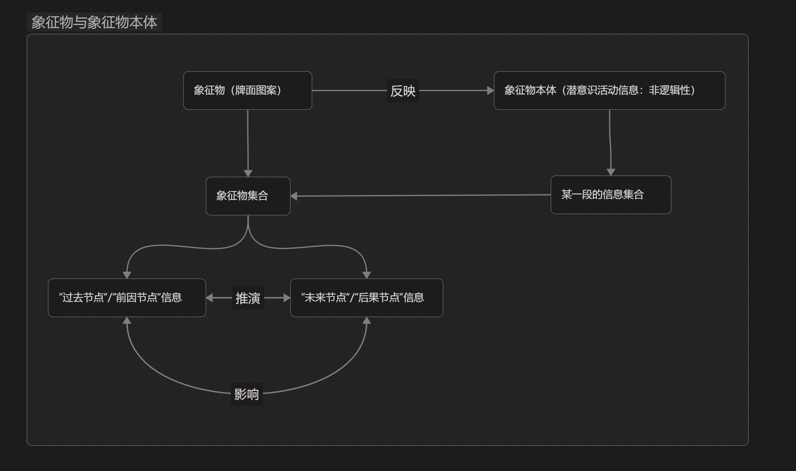
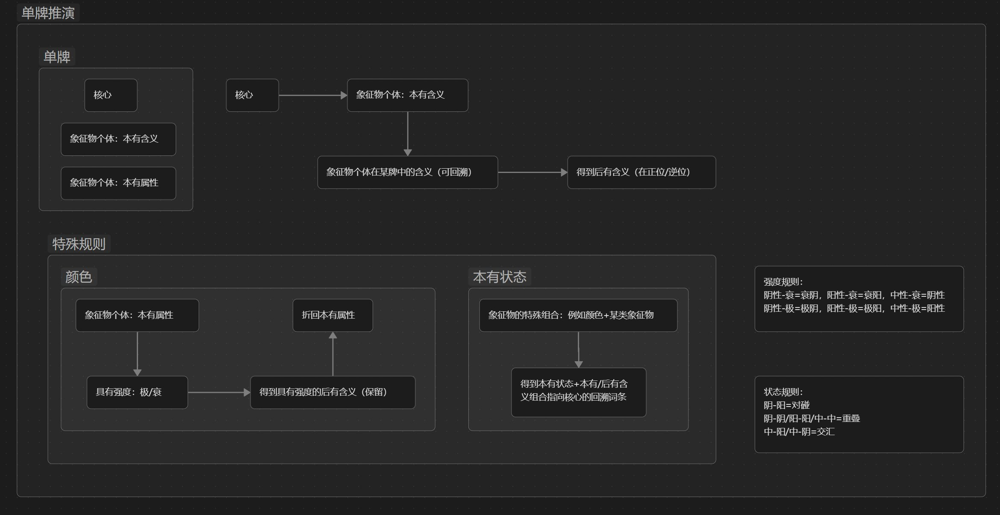
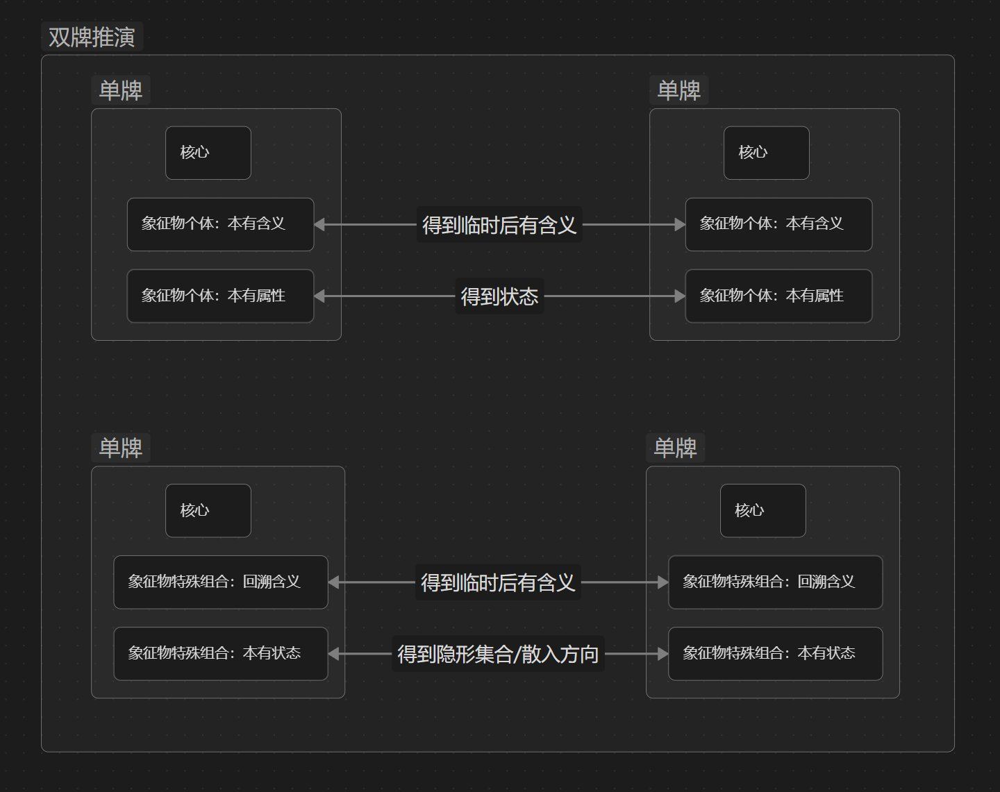

# 塔罗体系（新）

> 这是「关系推导法」的第一条分支。
> **通用层的概念与主仓库一致**（本有含义 / 本有属性 / 后有含义 / 即时状态 / 本有状态），
> 本文只写**塔罗这一支特有的部分**。

**本文结构**

1. 基础理论（象征物与本体、为什么具有推演性）
2. 单牌推演（拆象征物 → 定核心 → 正位/逆位词条 → 颜色特殊处理）
3. 双牌推演（属性交互 → 含义交互 → 聚 / 散）

---

## 一、基础理论（个人观点）

> **图**：象征物（牌面图案）反映象征物本体（潜意识信息）；
> 象征物与其本体共同构成**象征物集合**，对应“某一段”的信息；
> 这一段再推演出「过去 / 前因节点」与「未来 / 后果节点」，两者互相推演、互相影响。

### 1.1 象征物与象征物本体

象征物本体反映出潜意识活动中的碎片信息，象征物本体具象化为象征物，其中象征物本体与象征物之间的关系不由某个人规定，而由大多数人共识反推为潜意识可能表达的方式
	举例：太阳象征含义是“光明、温暖、男性、阳性、能量、明显的、表面上的、没有秘密的（属于阳的属性）”，于是在有出现太阳这个象征物的牌会带有其象征含义

当多个象征物本体集合在一起，对应的象征物自然增多，形成象征物集合，即潜意识活动的碎片集合在一起，所以象征物集合体在某个程度上反映着某一段潜意识活动

### 1.2 为什么具有预知性

潜意识中储存着并未刻意注意的信息，象征物集合体反映着这些信息。从而构成了关于“某一段”的信息描述，同时潜意识会根据“某一段”的信息描述推演出后面“另一段”的信息
#### 举例说明

时间举例：
“过去节点”的象征物集合体被对应描述，而“现在节点”是“过去节点”的“未来节点”，于是“现在节点”被“过去节点”所推演，”现在节点“反向影响”过去节点“，同理而言，“现在节点”的“未来节点‘也一样（推演为可能性，非确定性）
	即”现在是过去的未来，也是未来的过去“，在潜意识推演层面，”过去节点“和”未来节点“是重叠态

因果举例：
”前因节点“与”过程节点“，站在”前因节点“的角度”过程节点“等同于”后果节点“，于是当”前因节点“被象征物集合体对应描述时，自然推演”过程节点“，同理而言，”后果节点“是”过程节点“的自然推演结果，反过来，”后果节点“反向影响”前因节点“（推演为闭环，非线性）
	即”前因与后果是相互作用，在某个方面为重叠态“，在潜意识推演层面，”前因节点“与”后果节点“是重叠态

## 二、单牌推演

> **图**：核心 → 象征物本有含义 → 该象征物在某牌中的含义（可回溯）→ 后有含义。
> 下方是特殊规则：颜色走强度、特殊组合出本有状态。

首先，将单张牌中多个的象征物拆分为个体象征物，再将个体象征物拆分为本有含义与本有属性
将本有属性定义为三档：阴性、中性、阳性，本有含义为原本个体象征物的含义（由共识认为的含义）

其次，定义单张牌的”核心“。核心分**两个阶段**，不要混：

	1. **产生**：核心由这张牌具有的象征物**共同指向**（也就是共识认为的那个指向）——
	   这是**核心词的来源**。
	2. **使用**：核心定下来之后，再由它决定这些象征物**怎么解释**（正位、可溯源）。

	所以图上「核心 → 象征物本有含义」画的是**第 2 阶段**；第 1 阶段（象征物 → 核心）成立在先。

	逆位则由特殊的变化规则进行解释（其中，由可溯源的部分决定逆位的含义具有哪些，是什么样子的变化等，与正位同理达成可溯源）

	逆位的四种变化：**方向 / 显隐 / 程度 / 时间**。这里只列名称，**具体怎么变不展开**。
	（这四种变化**只在文字里说明，逻辑图里不画**。）

最后将：象征物本有含义与本有属性、象征物本有含义与核心词结合出来的正位词条、逆位词条整理为文件

在象征物中具有的特殊类进行单独处理：
	颜色对立：（特定规则）
		白（中）+黄（阳）=白（中）+黄（衰阳）
		白（中）+红（阳）=白（中）+红（极阳）
		白（中）+黑（中）=白（阴）+黑（阳）
	颜色深浅：（特殊变化）
		深+某颜色=某颜色本有含义向”极“
		浅+某颜色=某颜色本有含义向”衰“
	属性规则：
		阴性-衰=衰阴，阳性-衰=衰阳，中性-衰=阴性
		阴性-极=极阴，阳性-极=极阳，中性-极=阳性
	*由变化后的属性改变本有含义生成后有含义，再折回本有属性，后有含义保留*

	**三条澄清（2026-11 确认）**

	1. **对立三条都起作用**，但起作用的方式不同：
	   - 白+黄：黄 → **衰阳**
	   - 白+红：红 → **极阳**
	   - 白+黑：白 → **阴**、黑 → **阳**
	2. **只有白+黑改变属性归属**（阴阳互换）；
	   白+黄、白+红改的是**强度**，属性归属不变。旧版说法与新版本质一致。
	3. **中性往哪偏**：
	   - 中性 - 衰 → **阴**
	   - 中性 - 极 → **阳**
	   （对称）

**这里得到了单张具有的象征物json文件（包括处理的颜色处理）、正位可溯源词条json文件，逆位可溯源词条json文件**

## 二bis、两种「后有含义」

| 类型 | 在哪 | 固定吗 |
|---|---|---|
| **固定的后有含义** | **json 文件里**：单牌的象征物词条、正位词条、逆位词条、「回溯」词条 | **固定**，可查 |
| **即时的后有含义** | 两牌配对、聚、散时当场生成 | **不固定**，每次措辞可能不同 |

**一条通则（放在这里，后面反复用到）：**

> **可回溯**：每一条含义——尤其当场生成的那些——都必须能指回它的来源。
> 固定的可以查表核对；生成的必须指回它的那几个来源，别人才信得过。

---

## 三、双牌推演

> **图**：两条线**并行**——本有含义 ↔ 得到临时后有含义 ↔ 本有含义；
> 本有属性 ↔ 得到状态 ↔ 本有属性。下半张是特殊组合：回溯含义 ↔ 临时后有含义；本有状态 ↔ 隐形集合 / 散入方向。

首先**两条线各自处理各自的**（并行，不分先后）：本有含义与对方的本有含义交互，本有属性与对方的本有属性交互。

	**为什么并行**：这样每条线都能单独回溯到自己的来源。
	一旦把两条线拧在一起，回溯时就分不清“这句是含义来的，还是状态来的”。

	**交互是平等的**：前者与后者相互作用，**没有主次、没有权重**。
	不是“谁合谁”，也不是“合出来算谁”的——两边各自被对方影响。

属性交互：
A牌中某象征物的本有属性与B牌中的某象征物的本有属性产生即时状态
	属性规则：
	阴-阳=对碰
	阴-阴/阳-阳/中-中=重叠
	中-阳/中-阴=交汇

特殊机制：聚/散
前提：在原本的牌中必须具有本有状态
本有状态=原本的牌中通过特殊组合（例如：颜色＋某类象征物），特殊组合中具有两种属性，从而得到本有状态（这里单独处理后得到”回溯“含词条json文件，以便于后续聚/散使用和可溯源），为了不让”回溯“含义词条被偏移，以”某含义“+”某含义“指向”某核心“的格式储存

聚：在**三张牌**中找到各自的本有状态，筛选出本有状态一样的部分（例如：对碰+对碰+对碰）。
	这一部分变成”隐形集合“（由”回溯“含义词条 json 文件整合，临时生成、不固定）。
	**聚由特定的牌阵触发**；形成的隐形集合是**单方面影响**的，**方向由牌阵决定**。

散：在A牌中找到自己的本有状态，在另外的一或多张中找到与它一样的状态（例如：交汇+交汇），由A牌中的本有状态与另外的牌的本有状态找到”重叠态“，然后进行含义的整合。
	”重叠态“是临时生成的；**散出去的牌，方向同样由牌阵决定**。

	**产物是什么**：整合出来的是**一条含义**（形式上是「后有含义」）。
	它属于**即时的后有含义**——当场生成、不固定，按通则要求**可回溯**（指回它的来源）。

---

## 与主仓库的术语对照

| 本文用法 | 主仓库（关系推导法） |
|---|---|
| 标题「为什么具有预知性」 | **是疑问句**，下文自答：推演为可能性，非确定性；标题不改 |
| 象征物 / 象征物本体 | 元素 / 元素的本体含义 |
| 三档：阴性 / 中性 / 阳性 | 属性档位（可替换，塔罗用这三档） |
| 即时状态 / 本有状态 | 同名，含义一致 |
| 聚 / 散 | 同名；旧名分别是「歧点」「瑕点」 |

> 「预知性」出现在小标题里，是**设问**；正文已经答了「推演为可能性，非确定性」。
> 所以标题保留，不用改成「推演」。

---
