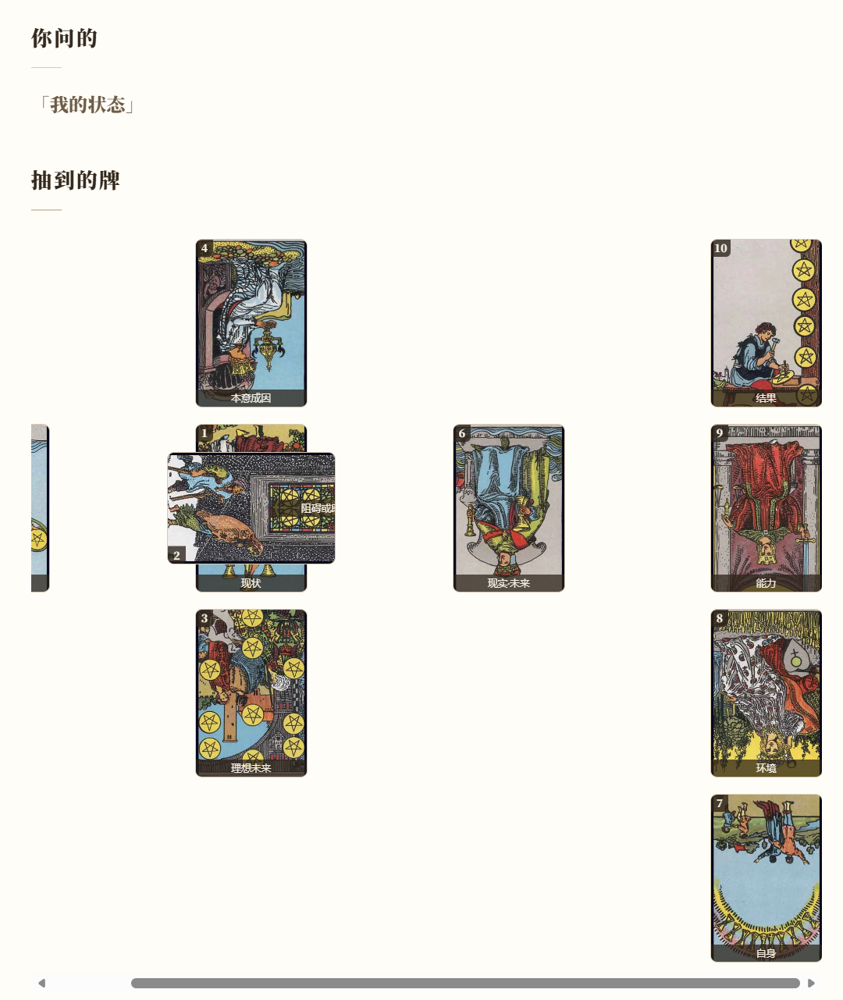
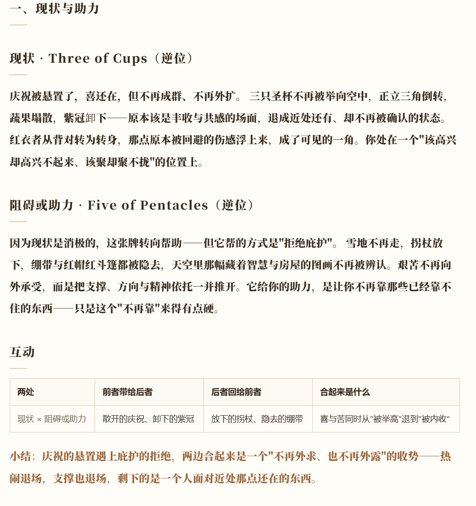
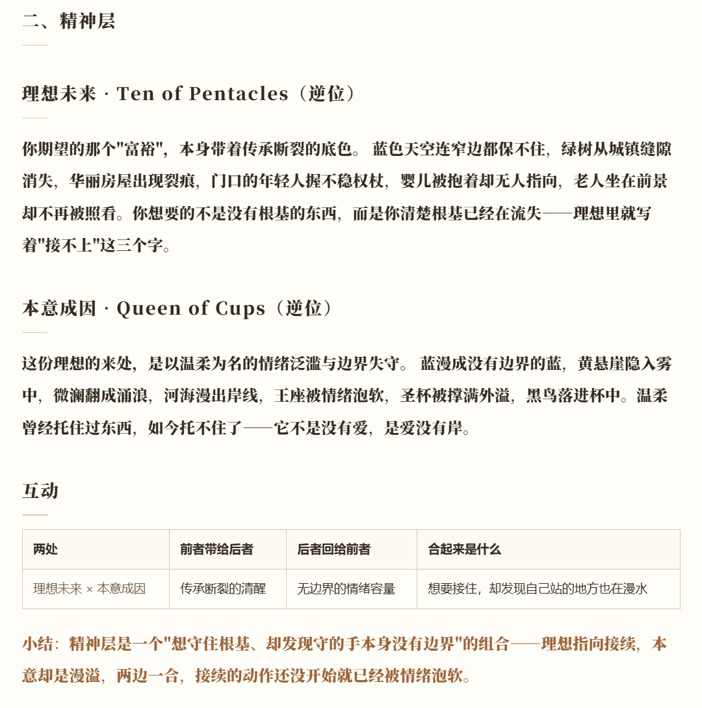
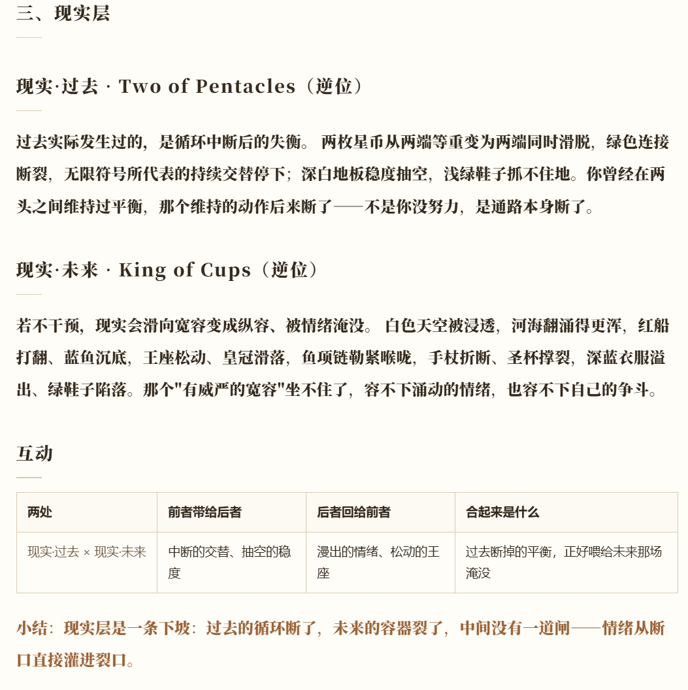
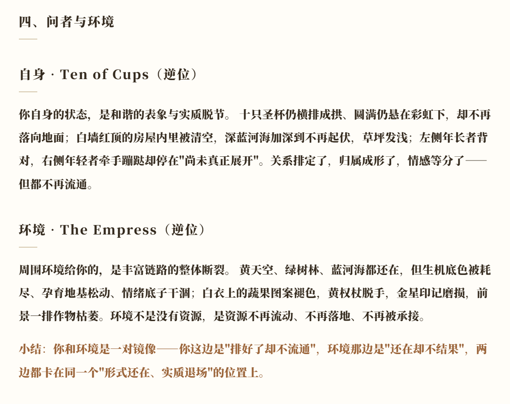
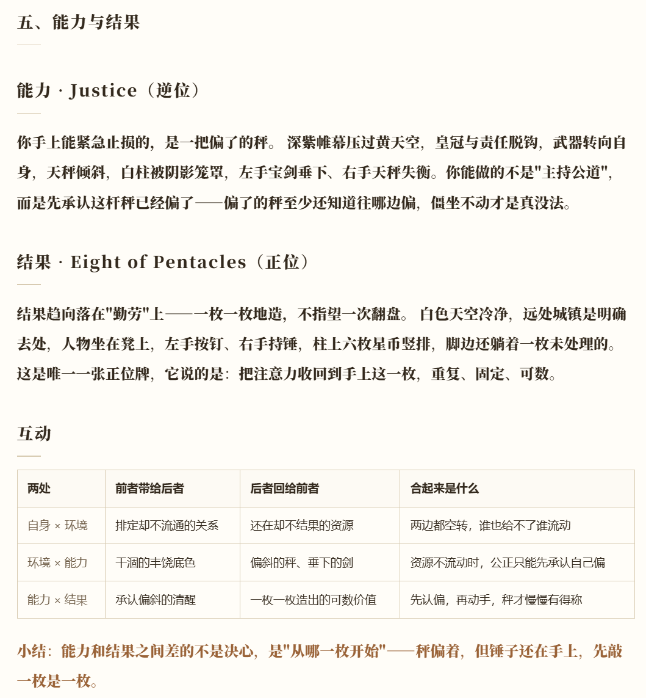
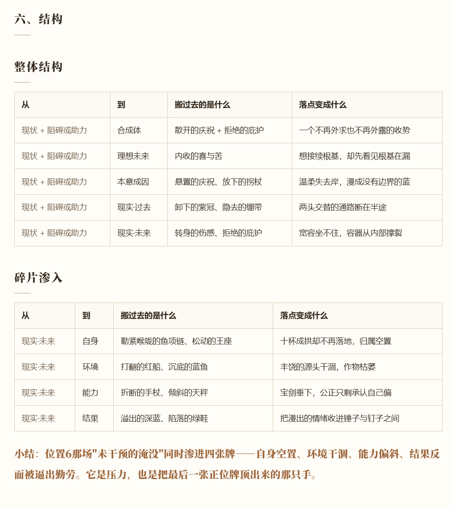
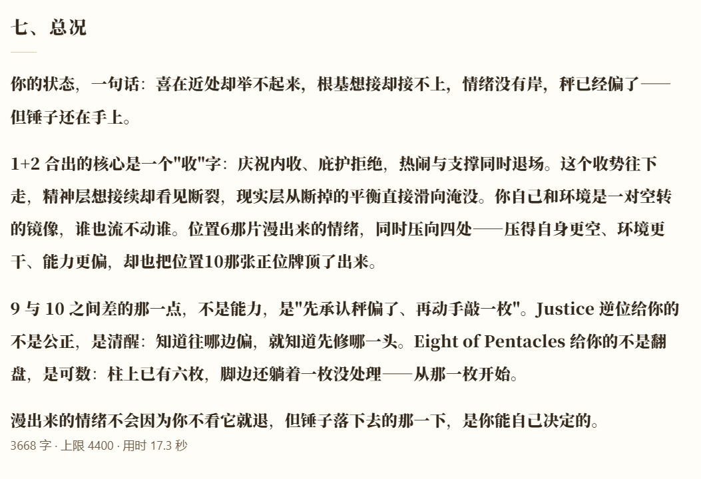

# 输出示例 · 凯尔特十字

> **示例数据**：程序实际跑出的一份完整报告，用来说明输出长什么样。
> 牌面与提问均为一次性测试，不代表任何真实个案。
>
> - 牌阵：凯尔特十字（10 张）
> - 提问：你的状态
> - 篇幅：3921 字（该牌阵上限 4400）

---

## 网页效果（截图）

这是同一份报告在网站里的渲染效果，按顺序排列。

### 抽到的牌

### 一、现状与助力

### 二、精神层

### 三、现实层

### 四、问者与环境

### 五、能力与结果

### 六、结构

### 七、总况

---

## 文字版（可直接复制）

# 凯尔特十字解读：你的状态

## 一、现状与助力

### 现状 · Queen of Swords（正位）

**你现在的状态是一手举着过去、一手握着剑，面朝未来坐着不动的孤独。** 深白王座上那些天使、婴儿、蝴蝶的标识说明这份孤独不是空的，它有阅历撑着，也有尊严划着边界。蓝色斗篷裹着白色云朵，理智在外、柔软在内，红色山坡退到远处，热情只作为远影存在。你不是没有情绪，是情绪被推远、拉长成一种恒常的背景。

### 阻碍或助力 · Death（正位）

**位置1是消极的孤独，所以位置2在这里是帮助——一次旧权威倒下、新一代接手的交替正在为你开路。** 黄太阳被白双塔和黑山挡着，但光没熄；黑船白帆在河上渡，黄沙里长出绿树，坟墓就摆在树间。死神握权杖、举黑旗、牵白马，旧国王躺倒、教皇跪求、年轻女性松手、年轻男性好奇打量。这份帮助不是温柔的，它要求你先让某个旧位置空出来。

### 互动

| 两处 | 前者带给后者 | 后者回给前者 | 合起来是什么 |
|---|---|---|---|
| 现状 × 阻碍或助力 | 孤独的理智边界与尊严位置 | 交替所需的倒下与渡河 | 孤独被允许结束一段，剑可以放下换船 |

**小结**：孤独有根基也有边界，而交替已经等在门口，旧位置不倒，新的就进不来。

## 二、精神层

### 理想未来 · Eight of Pentacles（正位）

**你期望的未来是把注意力收进一件具体的事里，一枚一枚地造出可数的价值。** 大面积白天空被调成纯粹冷静，远处深黄城镇与小路把目标放大，绿色草坪只余极小一点——你想要的不是野地，是有交换场所的劳作。深红凳子、黑色围裙、蓝色衣服层层裹着人物，凳子下还躺着一枚没处理的星币，柱上六枚竖排。坐姿加左手按钉、右手持锤，你理想中的状态是专注的、被动的、工序化的。

### 本意成因 · Seven of Wands（正位）

**这份勤劳的本意来自一段必须站稳的过去：你曾经站在六柄权杖中间，用第七柄撑住自己的立场。** 蓝白渐变的天空把思虑提纯到白，绿草坪与深蓝河海并置，你站在波动之上而非波动之外。衣服从绿到黄到深黄再到深红鞋，行动力层层加压到过旺，左手高举、右手向下、右脚扎实、整体朝右——坚毅的重心落在承重的那条腿上。勤劳不是凭空来的，是守出来的。

### 互动

| 两处 | 前者带给后者 | 后者回给前者 | 合起来是什么 |
|---|---|---|---|
| 理想未来 × 本意成因 | 工序化的专注与可数的成果 | 站稳阵地的过量行动力 | 守出来的力气被收进一张工作台，变成可重复的手艺 |

**小结**：你想把守阵的劲收进手艺里，理想是造东西，本意是曾经不得不站住。

## 三、现实层

### 现实·过去 · Four of Pentacles（逆位）

**实际发生过的事是：你曾经把自己封在四方阵里，头、胸、脚五枚星币全部钉死，然后这个结构从内部松了手。** 皇冠从头顶卸下、胸前星币从环抱中松开、脚下两枚滑出，黑色斗篷滑落使沉重暴露，深红从斗篷里外泄使压抑的冲动外放，浅蓝褪去使冷静更加不足，红鞋踏向别处。城镇退远、屋顶红热熄灭——财富场域本身失去生机后，占有欲连仅存的克制也放弃了。

### 现实·未来 · Ace of Cups（逆位）

**若不干预，接下来是喜悦被关在杯子里空转：满溢还在，出口没了。** 白鸽悬停不落，黑十字锁住白币，黄杯丰饶却不再主动承接，四股水流失去竖直方向与方阵约束，杯水不再回流河海。右来的给予撤回，上方的讯息隐没，向下的落地中断。情绪容量仍在，但拒绝接收新的支流——广阔转为自闭。

### 互动

| 两处 | 前者带给后者 | 后者回给前者 | 合起来是什么 |
|---|---|---|---|
| 现实·过去 × 现实·未来 | 松手后的空落与冲动外泄 | 满溢却封闭的自转 | 占有结构散架之后，情感找不到出口，在杯里空转 |

**小结**：过去是抓得太紧然后松了手，未来是松手之后情感无处可去，两头都不在流通里。

## 四、问者与环境

### 自身 · Five of Cups（正位）

**你现在的姿态是背对画面、低头看左边三只倒下的杯子，身后右边两只站着的你不管。** 黑色袍子整体罩住你，深黄土地在脚下重复，白色桥梁横在画面中却冷清，蓝色河海把两岸隔开。前景只有一点点绿在倒杯边上——希望是有的，极小。失望的样貌不是一无所有，是三杯倒在眼前、两杯留在身后，而你的目光全停在倾倒的那一侧。

### 环境 · Six of Swords（逆位）

**周围的环境本该是一次平静的过渡，现在过渡本身瓦解了。** 远山紫加深、权威重新逼近，河海蓝变浓、水面整体翻动，黄船失去行动力，划船者的黄蓝绿红逐一褪去，被载的紫衣权威不再安坐，黄斗篷被掀开，右侧波涛扩大、左侧水面也翻动。三个人物转回身面对来处，六把宝剑脱落，船头偏离未来方向。你想渡的那条河，船不走了。

**小结**：你盯着失去的，环境里的船又停摆了，两边合起来是原地不动地看倒下的杯子。

## 五、能力与结果

### 能力 · Four of Swords（正位）

**你手上真正能用的措施是停止——主动的、向内收束的静止，不是瘫软。** 两个四方阵一左一右，左边框着彩虹色隐藏图画，右边框内空无一物；三把白剑横着并排，锋芒融进白底，对峙解除。人物通体黄色躺着，收获被压在头下，宝剑横放在离手的地上，武装解除。双手摆出正立三角形，尖端朝上，静中含势。这是你紧急能做的事：把动作全部放下，把精神内容框起来供高，意识沉到下方。

### 结果 · Ten of Pentacles（逆位）

**趋向是富裕的传承断裂与根基流失：主干还在，但不再流通。** 蓝色天空连窄边都保不住，绿色树叶从城镇缝隙消失，黄色简房屋轮廓松散、出现空置与断裂。华丽房屋出现裂痕，墙从守护变成拒绝新事物的壁垒，两幅隐藏图画从隐蔽滑向被遗忘。年轻男性握不稳权杖，年轻女性不再守成，婴儿被抱在门口无人指向，白狗从守护滑向缺席。年长男性坐在那里不再被照看，蔬果织满外套却无人采摘。

### 互动

| 两处 | 前者带给后者 | 后者回给前者 | 合起来是什么 |
|---|---|---|---|
| 自身 × 环境 | 背身低头的注视方向 | 过渡瓦解后的原地翻涌 | 你看倒杯，船停摆，注意力与场景互相锁死在原地 |
| 环境 × 能力 | 过渡失败的动荡 | 主动停止的收势 | 船走不了，那就先躺下，停止成为对动荡的回应 |
| 能力 × 结果 | 放下武装、供高精神内容 | 传承断裂的空壳格局 | 停止若只停在收势，接手的动作仍不发生，空壳继续空 |

**小结**：你能做的是停下来、把剑放下，但结果趋向的是接手无人——停是对的，停在原地不接手就接不上。

## 六、结构

### 整体结构

| 从 | 到 | 搬过去的是什么 | 落点变成什么 |
|---|---|---|---|
| 现状 + 阻碍或助力 | 合成体 | 孤独的尊严边界 + 交替的倒下与渡河 | 一个允许结束、也要求放剑的过渡态 |
| 现状 + 阻碍或助力 | 理想未来 | 理智的冷净 + 交替的收割 | 把孤独收进工序，用劳作替代空坐 |
| 现状 + 阻碍或助力 | 本意成因 | 面朝右的持守 + 旧权威的倒下 | 守阵的力气被证明守过，也守到了尽头 |
| 现状 + 阻碍或助力 | 现实·过去 | 王座的边界 + 坟墓与空置 | 封闭的四方阵曾经立过，然后从内部散架 |
| 现状 + 阻碍或助力 | 现实·未来 | 蓝斗篷的理智 + 渡船的黑白反转 | 情感被理智关住，满溢找不到河海可回 |

### 碎片渗入

| 从 | 到 | 搬过去的是什么 | 落点变成什么 |
|---|---|---|---|
| 现实·未来 | 自身 | 红莲未燃、绿莲悬置、白鸽不落、杯水不回流、左下旧地 | 失望里那点绿更小，倒杯旁的生机被按回水下 |
| 现实·未来 | 环境 | 同上五片 | 过渡的船更划不动，情绪翻涌且没有接收方 |
| 现实·未来 | 能力 | 同上五片 | 停止不只是休息，是杯水不外流时的必要封闭 |
| 现实·未来 | 结果 | 同上五片 | 传承断裂之外再添一层：连情感也不传给下一代 |

**小结**：位置6那杯封闭的喜悦同时渗进你的注视、你的环境、你的停止和你的结果——它让四处都多了一层"有东西但不出手"的底色。

## 总况

你的状态可以一句话收住：**一个有阅历、有边界、手握宝剑的人，坐在孤独里，低头看着三只倒下的杯子，身后的两只不管；而一次旧位置倒下的交替已经等在门口，你手上有"停止"这张牌，结果趋向的却是接手无人。**

1+2 给出的核心是：孤独有尊严，交替已到场，剑可以放下换船。3+4 的精神层说，你想把守阵的劲收进手艺里——这个方向是对的，勤劳承接了坚毅。5+6 的现实层说，过去抓得太紧然后松了手，未来情感满溢却封闭空转，流通在两头都断了。7+8 的指导说，你盯着倒杯、船又停摆，注意力与环境互相锁死在原地。9+10 合起来看，差的那一步很清楚：**停止你有了，收势你也有了，但停止之后要有人接手——而现在的趋向是门口站着人却没人伸手。** 你能紧急做的是躺下、放剑、把精神内容供高；但停完之后，总得有只手去把右边那两只站着的杯子拿起来。
